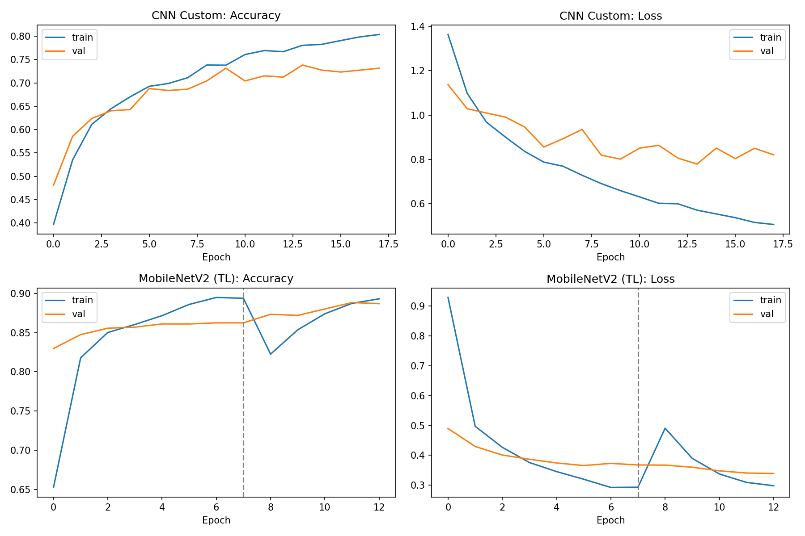
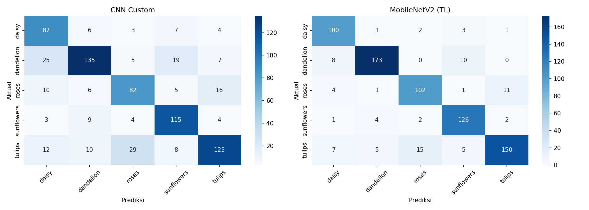
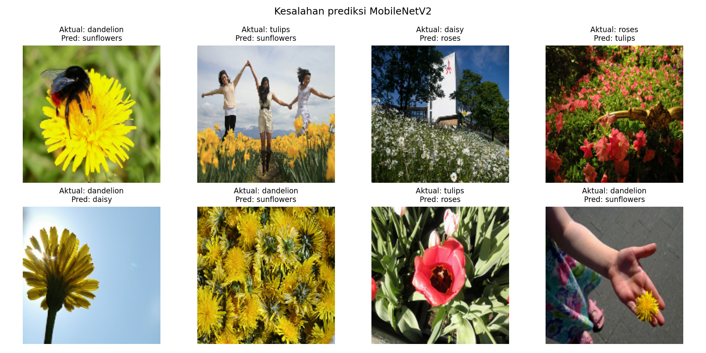

# Klasifikasi Bunga: CNN dari Nol vs Transfer Learning (MobileNetV2)

Tugas Individu Deep Learning: implementasi **CNN** dan **Transfer Learning**, lalu membandingkan keduanya pada dataset gambar yang sama.

- **Nama:** Diani Annisah
- **NIM:** H071241043

## Dataset

[TF Flowers](https://www.tensorflow.org/datasets/catalog/tf_flowers): 3.670 foto bunga dengan 5 kelas (`daisy`, `dandelion`, `roses`, `sunflowers`, `tulips`).

| Split | Jumlah gambar |
|---|---|
| Train (80%) | 2.936 |
| Validation (20%) | 734 |

Gambar di-resize ke 160x160 dengan batch size 32. Dataset diunduh otomatis oleh notebook.

## Arsitektur

**Model 1: CNN Custom (dilatih dari nol)**

```
Input 160x160x3
-> Data Augmentation (RandomFlip, RandomRotation, RandomZoom)
-> Rescaling (0-1)
-> Conv2D(32) + MaxPooling
-> Conv2D(64) + MaxPooling
-> Conv2D(128) + MaxPooling
-> Flatten -> Dropout(0.5) -> Dense(128, ReLU)
-> Dense(5, Softmax)
```

Optimizer Adam (lr 1e-3), loss `sparse_categorical_crossentropy`, maksimal 20 epoch dengan EarlyStopping (patience 4, `restore_best_weights=True`). Training berhenti di epoch 18.

**Model 2: Transfer Learning (MobileNetV2 pretrained ImageNet)**

```
Input 160x160x3
-> Data Augmentation
-> Rescaling ke [-1, 1]
-> MobileNetV2 (include_top=False, weights="imagenet")
-> GlobalAveragePooling2D -> Dropout(0.3)
-> Dense(5, Softmax)
```

Dilatih dalam dua tahap:
1. **Feature extraction:** base model dibekukan, hanya head baru yang dilatih (8 epoch, lr 1e-3).
2. **Fine-tuning:** 30 layer terakhir base model dibuka (5 epoch, lr 1e-5).

## Hasil

| Model | Parameter | Train Acc | Val Acc | Gap (Train-Val) | Val Loss | Waktu Training |
|---|---|---|---|---|---|---|
| CNN Custom | 6.647.621 | 80,38% | 73,16% | 7,22% | 0,8206 | 68,4 detik |
| MobileNetV2 (Transfer Learning) | 2.264.389 | 89,31% | **88,69%** | 0,61% | **0,3394** | 69,2 detik |

Catatan: angka CNN pada tabel diambil dari epoch terakhir. Classification report memakai bobot terbaik hasil early stopping, dengan akurasi 73,84%.

Waktu training diukur pada GPU NVIDIA T4 (Google Colab).

**Detail per kelas (MobileNetV2):**

| Kelas | Precision | Recall | F1-score | Support |
|---|---|---|---|---|
| daisy | 0,8333 | 0,9346 | 0,8811 | 107 |
| dandelion | 0,9402 | 0,9058 | 0,9227 | 191 |
| roses | 0,8430 | 0,8571 | 0,8500 | 119 |
| sunflowers | 0,8690 | 0,9333 | 0,9000 | 135 |
| tulips | 0,9146 | 0,8242 | 0,8671 | 182 |
| **Macro avg** | 0,8800 | 0,8910 | 0,8842 | 734 |

### Visualisasi

Kurva training (akurasi dan loss):



Confusion matrix:



Contoh prediksi yang salah (MobileNetV2):



## Analisis

MobileNetV2 dengan transfer learning mencapai akurasi validasi 88,69%, sekitar 15 poin persentase lebih tinggi dibanding CNN custom (73,16%). Val loss-nya juga jauh lebih rendah (0,339 vs 0,821).

CNN custom lebih overfit: gap akurasi train-val sebesar 7,22% dibanding 0,61% pada MobileNetV2, dan val loss CNN naik turun di kisaran 0,78-0,86 meski akurasi train terus naik. Augmentasi dan dropout membantu, tetapi belum cukup untuk dataset sekecil ini.

Waktu training keduanya hampir sama (sekitar 69 detik) pada GPU T4. MobileNetV2 memakai parameter hampir 3 kali lebih sedikit (2,26 juta vs 6,65 juta), dan hanya sebagian kecil yang dilatih pada tahap awal. Hasil ini sesuai dugaan bahwa pada dataset kecil (sekitar 2.900 gambar), fitur visual yang sudah dipelajari dari ImageNet lebih efektif daripada belajar dari nol.

Analisis kesalahan menunjukkan model MobileNetV2 sering keliru pada bunga kuning (dandelion terbaca sunflower), tulip merah terbaca roses, dan gambar yang memuat banyak objek lain selain bunga, seperti orang atau tangan. Kelas dengan F1 tertinggi adalah dandelion (0,92), sedangkan roses paling rendah (0,85).

## Cara Menjalankan

**Google Colab (disarankan):** buka `notebook.ipynb`, pilih Runtime -> Change runtime type -> T4 GPU, lalu Runtime -> Run all.

**Lokal:**

```bash
pip install -r requirements.txt
jupyter notebook notebook.ipynb
```

## Struktur Repository

```
.
├── README.md
├── notebook.ipynb
├── requirements.txt
└── images/
    ├── training_curves.png
    ├── confusion_matrix.png
    └── wrong_predictions.png
```
